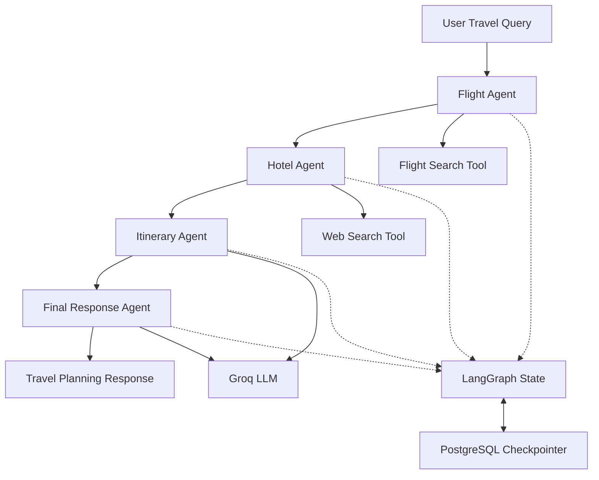

# AI Travel Planner Agent

An AI-powered travel planning backend built with Python, LangGraph, Groq, and PostgreSQL. The application retrieves flight information and hotel research, generates a travel itinerary using a large language model (LLM), and produces a consolidated travel-planning response.

## Features

* **Flight Search:** Retrieves flight information using a dedicated flight-search tool.
* **Hotel Research:** Searches for hotel information using a web-search tool.
* **AI-Generated Itinerary:** Generates a practical, budget-aware travel itinerary using an LLM.
* **Consolidated Response:** Combines flight results, hotel research, and itinerary details into a structured response.
* **Sequential Agent Workflow:** Orchestrates four agent nodes using LangGraph.
* **PostgreSQL Checkpointing:** Uses LangGraph's PostgreSQL checkpointer to persist workflow state.
* **Thread Identification:** Generates a unique thread ID when one is not provided.
* **Agent Execution Tracking:** Maintains a counter incremented by each agent node.

## Technology Stack

| Technology             | Purpose                           |
| ---------------------- | --------------------------------- |
| Python                 | Backend implementation            |
| LangGraph              | Agent workflow orchestration      |
| LangChain Core         | Message types and LLM interaction |
| Groq                   | Language-model integration        |
| `openai/gpt-oss-120b`  | Configured LLM                    |
| PostgreSQL             | Graph checkpoint persistence      |
| Psycopg                | PostgreSQL connectivity           |
| Tavily/Web Search Tool | Hotel research                    |
| Flight Search Tool     | Flight information retrieval      |
| `python-dotenv`        | Environment variable loading      |
| `certifi`              | TLS certificate configuration     |

## Architecture

The application executes four agent nodes sequentially.



## Agent Workflow

### 1. Flight Agent

Calls `search_flights()` with the user's travel request and stores the returned information in `flight_results`.

### 2. Hotel Agent

Uses `search_results()` to search for hotel information based on the user's travel request and stores the results in `hotel_results`.

### 3. Itinerary Agent

Uses the configured Groq LLM to generate a travel itinerary based on the user's request, flight information, and hotel research.

### 4. Final Response Agent

Uses the LLM to generate a consolidated response with the following sections:

1. Trip Summary
2. Flight Information
3. Hotel Suggestions
4. Day-by-Day Itinerary
5. Estimated Budget
6. Final Recommendations

## LangGraph State

The workflow maintains the following state fields:

| Field            | Description                                    |
| ---------------- | ---------------------------------------------- |
| `messages`       | Messages accumulated during workflow execution |
| `user_query`     | Original travel request                        |
| `flight_results` | Results returned by the flight-search tool     |
| `hotel_results`  | Results returned by the web-search tool        |
| `itinerary`      | LLM-generated itinerary                        |
| `llm_calls`      | Counter incremented by each agent node         |

## PostgreSQL Checkpointing

The application uses `PostgresSaver` to configure PostgreSQL-backed graph checkpointing.

The database connection is established using `DATABASE_URL`. If the connection string does not already contain an `sslmode` parameter, the code appends `sslmode=require`.

The checkpointer is initialized using `checkpointer.setup()` and attached to the compiled LangGraph workflow.

Each invocation uses a thread ID to associate the workflow with a specific thread.

## Backend Function

The `run_travel_agent()` function executes the workflow.

```python
run_travel_agent(
    user_input: str,
    thread_id: str | None = None
)
```

### Parameters

* `user_input`: The user's travel request.
* `thread_id`: An optional thread identifier. A new identifier is generated if one is not provided.

### Return Values

The function returns a dictionary containing:

| Key              | Description                                |
| ---------------- | ------------------------------------------ |
| `thread_id`      | Identifier used for the workflow execution |
| `answer`         | Final travel-planning response             |
| `flight_results` | Retrieved flight information               |
| `hotel_results`  | Retrieved hotel research                   |
| `itinerary`      | Generated itinerary                        |
| `llm_calls`      | Counter incremented by the agent nodes     |

## Environment Variables

The backend requires the following environment variables:

| Variable       | Purpose                                   |
| -------------- | ----------------------------------------- |
| `GROQ_API_KEY` | Authenticates with Groq                   |
| `DATABASE_URL` | Provides the PostgreSQL connection string |

Additional environment variables may be required by the implementations of `tools/flight_tool.py` and `tools/tavily_tool.py`.

## Project Structure

```text
project/
├── app.py
├── backend.py
├── tools/
│   ├── flight_tool.py
│   └── tavily_tool.py
├── requirements.txt
├── Dockerfile
└── README.md
```

This structure assumes the FastAPI application is in `app.py`, the provided agent code is in `backend.py`, and the search tools are located in the `tools` directory. Adjust filenames to match your actual project.

## Notes

* Flight information depends on the configured flight-search tool.
* Hotel information depends on the configured web-search tool.
* The final response and itinerary are generated by the LLM.
* Flight ticket prices may not be available in the retrieved results.
* The `llm_calls` counter is incremented by all four agent nodes; it does not currently measure actual LLM API calls.

## Application URL
https://travel-planner-lwz5.onrender.com/

## Evaluation
https://smith.langchain.com/o/369f7b73-a46b-4c9f-820f-2f16a33b1414/a/travel-planner-agent
